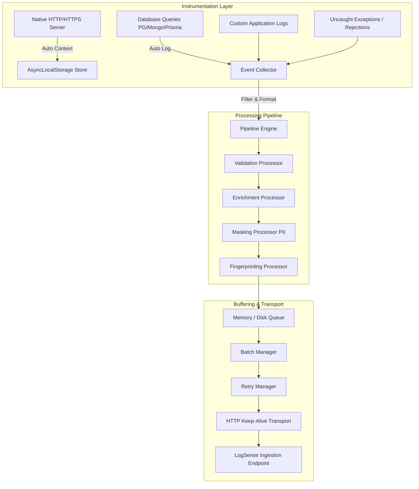

# LogSense Node.js SDK Developer Documentation

Welcome to the official developer documentation for the **LogSense Node.js SDK**.

LogSense is an enterprise-grade observability and structured logging platform built specifically for high-throughput, low-latency Node.js microservices and web applications. It shifts the burden of logging, context propagation, error tracking, database query performance logging, and system metrics aggregation from your application code into an optimized asynchronous pipeline.

---

## Why LogSense?

Traditional logging libraries (like Winston or Bunyan) write raw strings or basic JSON to stdout or file descriptors. They require developers to manually inject trace IDs, construct complex payloads, catch errors, format stack traces, and manage transport details. 

LogSense re-imagines logging by combining **structured JSON serialization**, **AsyncLocalStorage context tracking**, **automated instrumentation hooks**, and a **background batch queue** into a unified SDK.

### Core Value Propositions

*   **Zero-Overhead Asynchronous Execution**: All telemetry collection happens in the background. The queue and batch managers ensure that network round-trips to LogSense ingestion servers never block the main Node.js event loop or delay HTTP client responses.
*   **Automatic HTTP & DB Context Correlation**: With a single Express middleware, every downstream log—whether emitted by a database driver, a Redis client, or a custom logger statement—is automatically stamped with the active request's `requestId`, HTTP path, method, and user identity context.
*   **Built-in Resiliency and Backpressure Management**: Through exponential backoff, jittered retries, and an optional Disk Queue, the SDK guarantees that logs are preserved during network partitions and server-side outages without consuming excessive server memory.
*   **Drop-in Integration**: Support for automatic patching of native `http`/`https` modules, Axios, Fetch, PostgreSQL (`pg`), MySQL (`mysql2`), MongoDB (`mongoose`), and Prisma.

---

## Quick Install

```bash
npm i @utkarshpayal/logsense-sdk
```

```typescript
import { LogSense } from "@utkarshpayal/logsense-sdk";
import { logsenseMiddleware } from "@utkarshpayal/logsense-sdk/express";
```

---

## High-Level Architecture

LogSense is divided into five core layers that process telemetry data from creation to ingestion:



---

## Documentation Navigation

This documentation is designed to take you from a local prototype to a highly optimized, custom-tailored enterprise setup:

1.  **[Getting Started](getting-started/installation-and-setup.md)**: Install the SDK, configure your first project, and send your first test events.
2.  **[SDK Core & Configuration](sdk/configuration.md)**: Learn about configuration profiles, customization parameters, and tuning memory boundaries.
3.  **[Client & Logging APIs](sdk/client-and-logger.md)**: Explore structured logging levels, child loggers, and immediate flushing capabilities.
4.  **[Middleware Observability](middleware/express.md)**: Set up the Express middleware to capture requests, responses, slow requests, and route errors.
5.  **[Automatic Instrumentation](instrumentation/http-and-db.md)**: Enable automatic logging for external API calls and database query execution.
6.  **[SDK Architecture & Pipeline](architecture/logging-pipeline-and-context.md)**: Discover how AsyncLocalStorage, batching, queuing, and retries work under the hood.
7.  **[Processors & Plugins](advanced/custom-plugins-and-processors.md)**: Write custom plugins to filter, enrich, or redirect telemetry.
8.  **[API Reference](api-reference/sdk-api.md)**: Exhaustive TypeScript API catalog with signatures, types, and descriptions.
9.  **[End-to-End Examples](examples/production-use-cases.md)**: Complete microservice, cron, and API server setups.
10. **[Production Best Practices](best-practices/production-tuning.md)**: Tuning guidelines for performance, PII safety, and log retention.
11. **[Troubleshooting & Diagnostics](troubleshooting/diagnostics.md)**: Diagnosing missing logs, memory issues, or connection failures.
12. **[FAQ](faq/common-questions.md)**: Answers to common architecture, performance, and scaling questions.
