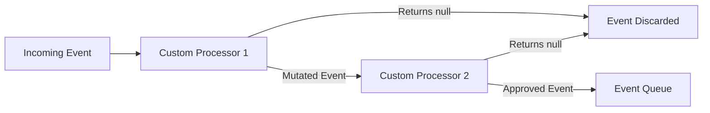
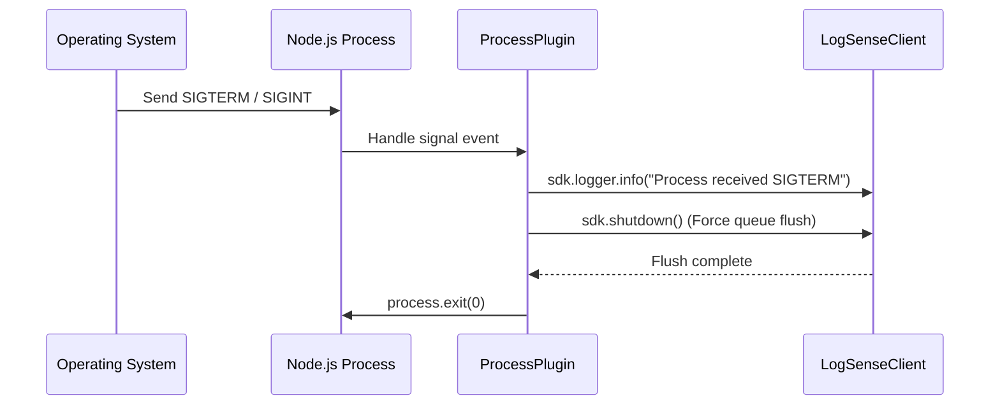

# Processors & Plugins Guide

This guide covers extending the LogSense telemetry pipeline with custom processors and process plugins.

---

# Purpose

The processor and plugin architecture allows you to customize how the SDK behaves in different environments. Processors run inline to filter or enrich events before they are queued, while Plugins extend the SDK lifecycle to handle events like system shutdowns or runtime errors.

---

# Custom Pipeline Processors

A **Processor** is a middleware function that intercepts events. It receives an event payload and returns either the modified event (to enrich or mutate it) or `null` (to discard it).



### Implementing a Custom Processor
To register a processor, pass it to the `processors` array during initialization:
```typescript
import { LogSense, LogEvent } from "@logsense/node";

const client = new LogSense({
  apiKey: "...",
  processors: [
    // Example: Add a custom deployment tag to all events
    (event: LogEvent) => {
      event.metadata = {
        ...event.metadata,
        deploymentId: "deploy_v12_blue"
      };
      return event;
    },
    // Example: Discard debug-level events from a specific test module
    (event: LogEvent) => {
      if (event.severity === "debug" && event.metadata.module === "billing-test") {
        return null; // Drop this event
      }
      return event;
    }
  ]
});
```

---

# Graceful Shutdown Management (`ProcessPlugin`)

The **`ProcessPlugin`** monitors your Node.js process state. It listens for termination signals and system events to ensure all buffered logs are sent before the process exits.



### How to Install the Process Plugin
The `ProcessPlugin` hooks into standard termination signals (`SIGINT`, `SIGTERM`) and process exit triggers (`beforeExit`):
```typescript
import { LogSense } from "@logsense/node";
import { ProcessPlugin } from "@logsense/node/plugins";

const sdk = new LogSense({ apiKey: "..." });

// Initialize and install the process listeners
const processPlugin = new ProcessPlugin(sdk, {
  exitCode: 0,           // Fallback code when exiting on signals
  timeoutMs: 3000        // Force exit if flush hangs longer than 3s
});

processPlugin.install();
```

---

# Design & Implementation Guidelines

### Non-blocking Execution
Processors run synchronously during logging calls (e.g. `logger.info`). Avoid executing expensive operations like synchronous disk I/O, heavy regex operations, or blocking loops inside your processors, as this will degrade application throughput.

### Thread and Scope Safety
Processors must be pure functions that do not share state across concurrent calls. Modifying global variables inside a processor can lead to race conditions under high concurrent traffic.

### Exception Safety
If a processor throws an error, the SDK wraps it in a try-catch block, prints an error message to `stderr` (if `debug: true` is active), and forwards the original unmodified event to the queue to prevent log loss.
```typescript
// Safe processor pattern
(event) => {
  try {
    // Perform parsing logic here
    event.metadata.parsedId = parseId(event.metadata.rawId);
  } catch (err) {
    // Fail silently in production
  }
  return event;
};
```
