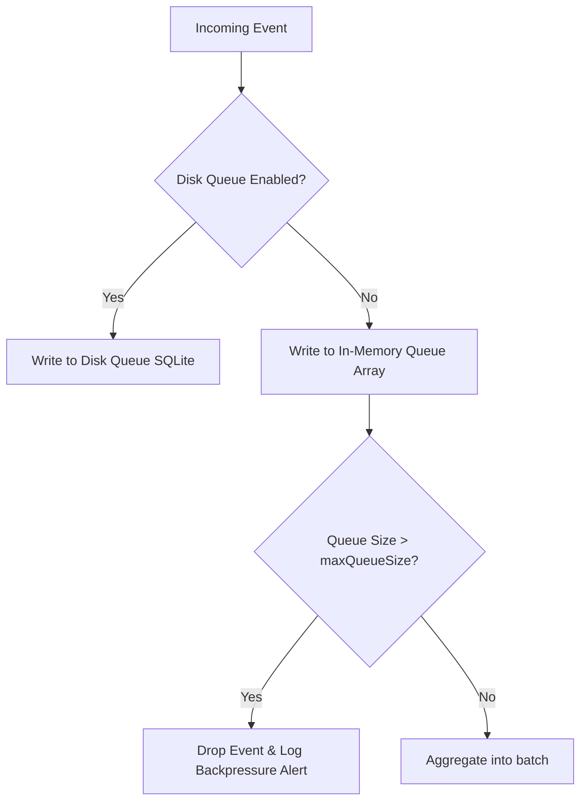

# Logging Pipeline & Context Architecture

This page covers the internal architecture of the LogSense context propagation and logging pipeline.

---

# Architecture Map

Telemetry processing is handled by a series of modular processors, a queue, and a retryable HTTP transport:

```mermaid
graph LR
    subgraph Execution Context
        ALS[AsyncLocalStorage] --> |Active Context| Event[BaseEvent]
    end

    subgraph Logging Pipeline
        Event --> Val[1. Validation]
        Val --> Enrich[2. Enrichment]
        Enrich --> Mask[3. PII Masking]
        Mask --> Sample[4. Sampling]
        Sample --> Finger[5. Fingerprinting]
    end

    subgraph Delivery Engine
        Finger --> Queue[Memory / Disk Queue]
        Queue --> Batch[Batch Manager]
        Batch --> Retry[Retry Manager]
        Retry --> Trans[HTTP Keep-Alive]
    end
```



---

# 1. Asherent Context Correlation (`AsyncLocalStorage`)

Node.js is asynchronous but single-threaded. Standard request correlation relies on passing logger references or correlation IDs manually down call stacks. LogSense uses **`AsyncLocalStorage`** to store request context implicitly across asynchronous boundaries.

When the Express middleware receives a request, it calls `contextStore.run(context, next)`. Any code executed within this execution path (including async database queries or nested helper promises) shares access to the request context:
```typescript
import { contextStore } from "@logsense/node/context";

// Access the active trace variables anywhere in your app code
const activeContext = contextStore.get();
console.log(activeContext?.requestId); // Stamped automatically on all logs
```

---

# 2. Pipeline Processors

All events pass through five processing stages before entering the transmission queue:

1.  **Validation**: Ensures that the payload has a valid severity level, a non-empty message, a valid timestamp, and required project metadata.
2.  **Enrichment**: Stamps host metrics onto the log payload: hostname, OS type, process ID (PID), Node.js version, and SDK version.
3.  **PII Masking**: Recursively traverses the metadata object, replacing values of keys that match your configured masking rules (like `password` or `card_number`) with `[MASKED]`.
4.  **Sampling**: Applies sampling rates. In high-traffic scenarios, you can drop a percentage of debug or info logs to save bandwidth and storage.
5.  **Fingerprinting**: For exceptions, the SDK parses the stack trace and generates a hash key. Events with matching fingerprints are grouped into a single issue on the dashboard.

---

# 3. Queue Management & Backpressure

LogSense supports two queuing modes:



### Memory Queue
Stores events in a local array. It is highly optimized but vulnerable to process crashes. If the queue size exceeds `maxQueueSize`, oldest events are dropped to prevent memory leaks (backpressure safety).

### Disk Queue (Production Profile Default)
If the ingestion servers are unreachable, events are written to a lightweight SQLite database on disk. When connection is restored, the SDK flushes events from the disk back to the ingestion server.

---

# 4. Batching, Retry, and Transport

### Dynamic Batching
The batch manager bundles events into a single array to minimize HTTP request overhead. A batch is dispatched when:
*   The number of buffered events reaches `batchSize`.
*   The timer reaches the `flushInterval` threshold.

### Retry with Exponential Backoff and Jitter
If the ingestion server returns a retryable status code (`500`, `503`, or rate-limited `429`), the SDK schedules a retry using exponential backoff with full jitter:

$$\text{delay} = \text{random}(0, \min(\text{maxDelayMs}, \text{baseDelayMs} \times 2^{\text{attempt}}))$$

Adding random noise (jitter) to the retry interval prevents thundering herd problems, where multiple client nodes retry failed requests simultaneously and overwhelm the ingestion servers.
If an event fails after `maxRetries` (or if the server returns a non-retryable error like `400 Bad Request` or `401 Unauthorized`), the payload is sent to the local Dead Letter Queue (DLQ) file on disk for manual recovery.
