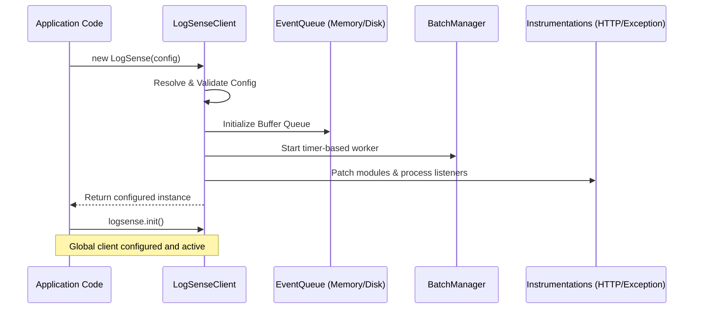

# Installation & Setup Guide

This guide covers setting up the LogSense Node.js SDK from scratch in your application.

---

# Purpose

The installation and setup sequence establishes a connection between your Node.js application and the LogSense ingestion servers. It loads the required pipeline components, hooks process-level handlers, and prepares the telemetry queues before your application begins serving traffic.

---

# Problem it Solves

Setting up observability in traditional systems often involves writing complex custom initialization wrappers, configuring separate handlers for uncaught exceptions, and manually patching web server routes. The LogSense setup sequence solves this by configuring a single, globally accessible observability client with safe defaults in just a few lines of code.

---

# Setup Flow

The following diagram illustrates the SDK initialization and boot phase:



---

# Configuration

To initialize the client, you must provide your API Key and workspace descriptors. These can be passed via environment variables or explicitly in the constructor:

| Variable | Config Option | Type | Description |
| :--- | :--- | :--- | :--- |
| `LOGSENSE_API_KEY` | `apiKey` | `string` | **Required.** Your unique project ingestion token. |
| `LOGSENSE_SERVICE` | `service` | `string` | **Required.** Name of the microservice (e.g. `auth-api`). |
| `LOGSENSE_ORG_ID` | `organizationId` | `string` | **Required.** Your organization identifier. |
| `LOGSENSE_PROJECT_ID` | `projectId` | `string` | **Required.** Your workspace project identifier. |
| `LOGSENSE_ENVIRONMENT` | `environment` | `string` | Target environment (e.g., `production`, `development`). |

---

# Code Examples

### 1. Minimal Setup (Zero-Config Environment Variables)

Define your configuration in your environment:
```bash
export LOGSENSE_API_KEY="ls_key_xxxxxxxxx"
export LOGSENSE_SERVICE="gateway-service"
export LOGSENSE_ORG_ID="org_123"
export LOGSENSE_PROJECT_ID="proj_abc"
```

Initialize the global singleton:
```typescript
import { logsense } from "@logsense/node";

// Automatically loads from environment variables
logsense.init();

// Send an info event
logsense.logger.info("Service started successfully");
```

### 2. Manual Config Initialization (Express App)

```typescript
import express from "express";
import { LogSense } from "@logsense/node";

const app = express();

const logger = new LogSense({
  apiKey: "ls_key_xxxxxxxxx",
  service: "user-portal-api",
  organizationId: "org_987",
  projectId: "proj_xyz",
  environment: "staging",
  debug: true
});

logger.logger.info("Express application bootstrap initialized");
```

### 3. Production Multi-Service Microservice Setup

```typescript
import { LogSense } from "@logsense/node";

const logsenseClient = new LogSense({
  apiKey: process.env.LOGSENSE_API_KEY!,
  service: process.env.SERVICE_NAME ?? "core-worker",
  organizationId: process.env.LOGSENSE_ORG_ID!,
  projectId: process.env.LOGSENSE_PROJECT_ID!,
  environment: process.env.NODE_ENV ?? "production",
  serviceVersion: process.env.APP_VERSION ?? "1.4.2",
  profile: "production", // automatically enables disk queueing
  diskQueueEnabled: true,
  diskQueueDir: "./.logsense/cache-queue"
});

export const logger = logsenseClient.logger;
export default logsenseClient;
```

---

# Internal Flow

1.  **Validation**: The `validateConfig` module verifies that your API credentials, organization parameters, and server paths exist and match formatting guidelines. If any required parameters are missing, the SDK throws a detailed initialization error immediately to prevent silent failure.
2.  **Memory Allocation**: The selected `EventQueue` (either `MemoryQueue` or `DiskQueue`) allocates its internal buffers.
3.  **Daemon Worker**: The `BatchManager` starts an asynchronous background timer based on `flushInterval`.
4.  **Auto Patching**: Unless `disableInstrumentation` is set to `true`, the SDK intercepts Node's standard module loaders to automatically inject tracking hooks into core communication libraries.

---

# Edge Cases & Troubleshooting

### Error: `[LogSense] Invalid Configuration`
This error occurs if any required variables are missing or incorrect:
*   Make sure `LOGSENSE_API_KEY`, `LOGSENSE_SERVICE`, `LOGSENSE_ORG_ID`, and `LOGSENSE_PROJECT_ID` are set.
*   Ensure that numerical properties like `batchSize` and `flushInterval` are positive integers greater than `0`.

### Node.js Process Exiting Too Early
If you write a simple test script that logs an event and then exits immediately, Node might close the process before the background queue has run its first flush. In simple CLI tools or scripts, always call `await logsense.shutdown()` before exiting.
```typescript
import { logsense } from "@logsense/node";

logsense.init();
logsense.logger.info("One-off cron job finished");

// Force all queued logs to be sent immediately before exiting
await logsense.shutdown();
```
