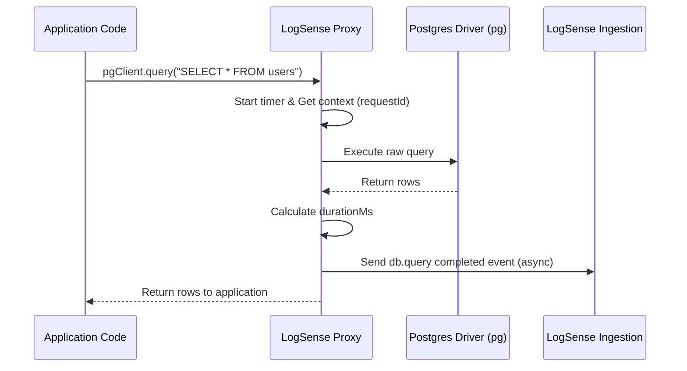

# Automatic Instrumentation Guide

This guide details automatic instrumentation for HTTP clients and databases in the LogSense SDK.

---

# Purpose

Instrumentation hooks capture external communication metrics (HTTP API requests, DB queries, Redis cache transactions) without requiring you to manually write wrappers around driver calls. These hooks measure call duration, detect failed queries, and link operations to the active request context.

---

# How Instrumentation Works

Node.js uses a single-threaded runtime where module loading is synchronous. When the LogSense SDK boots, it intercepts the `require` / `import` statements of supported packages. It replaces the core query methods with decorated proxy versions.



---

# Supported Integration Modules

## 1. PostgreSQL Wrapper (`pg`)
Puts a proxy wrapper around the `pg.Client` and `pg.Pool` prototype query methods.
*   **Captured Data**: Query text, execution status, execution duration, rows affected.
*   **Sensitive Data Protection**: Automatically strips values from parameter slots to protect sensitive data.

## 2. Mongoose & MongoDB Plugin
A schema-level plugin that hooks Mongoose query execution hooks (`find`, `updateOne`, `save`, etc.).
*   **Captured Data**: Model name, operation, criteria parameters, validation status.

## 3. Prisma Extension
Integrates as a Prisma Client Extension using `$extends`.
*   **Captured Data**: Model name, method name, query arguments, duration.

## 4. MySQL2 Wrapper
Intercepts `mysql2` connections and pool configurations.
*   **Captured Data**: SQL statement, execution time, number of rows affected.

---

# Code Examples

### 1. Connecting Mongoose Database Logging
```typescript
import mongoose from "mongoose";
import { LogSense, mongooseLogSensePlugin } from "@utkarshpayal/logsense-sdk";

const sdk = new LogSense({ apiKey: "..." });

// Apply the logging hook to all collections globally
mongoose.plugin((schema) => mongooseLogSensePlugin(schema, { collector: sdk.collector }));

// Standard schema and model definition
const userSchema = new mongoose.Schema({ name: String });
const User = mongoose.model("User", userSchema);
```

### 2. Wrapping Postgres (`pg`) Connections
```typescript
import pg from "pg";
import { LogSense, wrapPg } from "@utkarshpayal/logsense-sdk";

const sdk = new LogSense({ apiKey: "..." });
const pool = new pg.Pool({ connectionString: "postgresql://localhost:5432/db" });

// Decorate the pool to log query timings and failures
wrapPg(pool, sdk.collector);

// Queries are now automatically logged
await pool.query("SELECT * FROM organization WHERE active = $1", [true]);
```

### 3. Prisma Client Integration
```typescript
import { PrismaClient } from "@prisma/client";
import { LogSense, prismaLogSenseExtension } from "@utkarshpayal/logsense-sdk";

const sdk = new LogSense({ apiKey: "..." });
const prismaRaw = new PrismaClient();

// Extend Prisma with the LogSense logger extension
const prisma = prismaRaw.$extends(prismaLogSenseExtension(sdk.collector));

// Queries on this extended client will emit structured logs
const activeUsers = await prisma.user.findMany({ where: { status: "ACTIVE" } });
```

---

# Performance Impact

Because wrapping intercepts call prototype chains, it introduces a minimal overhead of approximately `1` to `3` microseconds per query evaluation. The actual database execution time (usually between `2` and `100` milliseconds) remains the dominant latency factor.
To ensure thread and memory safety:
*   Telemetry events are pushed asynchronously to the queue. The query resolution path is never blocked.
*   Raw payload collection is bounded to `1000` characters to prevent telemetry logs from swelling heap memory.

---

# PII and Query String Security

By default, database query instrumentation strips query variables from logs to prevent PII exposure:
*   **Safe Log**: `SELECT * FROM users WHERE email = $1 AND password = $2`
*   **Unsafe Log (Avoided)**: `SELECT * FROM users WHERE email = "bob@example.com" AND password = "secret123"`
Ensure your application uses parameterized queries (e.g. prepared statements) rather than inline string concatenations. This is essential for both SQL injection defense and log data safety.
