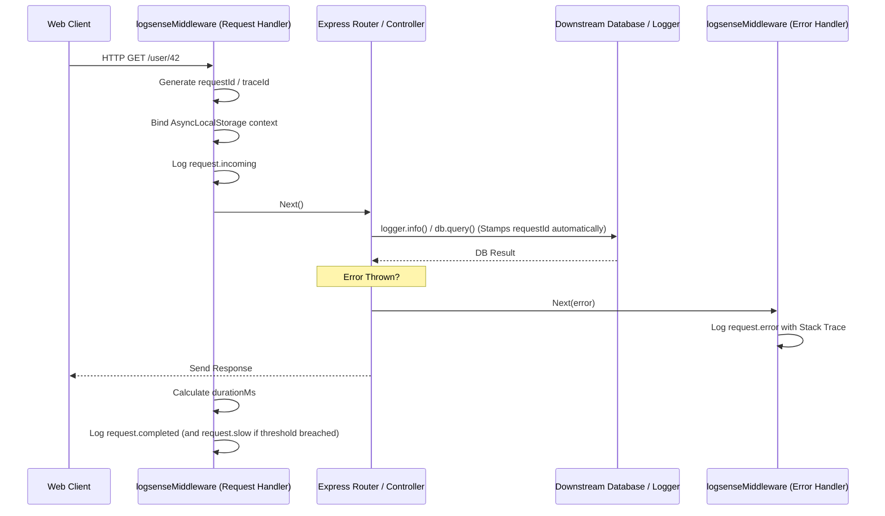

# Express Middleware Guide

This page details the implementation, lifecycle, and configurations of the LogSense Express Middleware.

---

# Purpose

The Express Middleware provides automated, zero-configuration HTTP request/response observability. It hooks into the incoming request phase to start tracking execution time, sets up AsyncLocalStorage contexts for downstream correlation, generates trace IDs, warns on slow responses, and captures unhandled exceptions.

---

# Problem it Solves

Without automated middleware, developers must write boilerplate code at the beginning and end of every controller to log incoming parameters, status codes, and execution durations. Furthermore, correlation IDs must be manually threaded through every helper function. The LogSense middleware does this automatically for every incoming connection.

---

# Middleware Request Lifecycle



---

# Configuration Options

The middleware factory function `logsenseMiddleware(sdk, options)` accepts the following properties:

| Option | Type | Default Value | Description |
| :--- | :--- | :--- | :--- |
| `slowThresholdMs` | `number` | `300` | Execution duration in milliseconds that triggers a `Severity.WARN` slow request event. |
| `metadata` | `object` | `{}` | Static properties appended to all request/response log payloads. |
| `ignoreRoutes` | `string[]` | `["/healthz", "/metrics"]` | List of URL paths that are excluded from HTTP logging. |

---

# Code Examples

### 1. Basic Integration
```typescript
import express from "express";
import { LogSense } from "@utkarshpayal/logsense-sdk";
import { logsenseMiddleware } from "@utkarshpayal/logsense-sdk/express";

const app = express();
const sdk = new LogSense({ apiKey: "..." });

const [logRequests, logErrors] = logsenseMiddleware(sdk);

app.use(logRequests); // Must be registered FIRST
app.get("/hello", (req, res) => res.send("World"));
app.use(logErrors);   // Must be registered LAST
```

### 2. Custom Observability Configuration
```typescript
import express from "express";
import { LogSense } from "@utkarshpayal/logsense-sdk";
import { logsenseMiddleware } from "@utkarshpayal/logsense-sdk/express";

const app = express();
const sdk = new LogSense({ apiKey: "..." });

const [logRequests, logErrors] = logsenseMiddleware(sdk, {
  slowThresholdMs: 150, // Flag any request exceeding 150ms
  metadata: {
    region: "eu-central-1",
    tier: "api-gateway"
  },
  ignoreRoutes: ["/favicon.ico", "/healthz"]
});

app.use(logRequests);
app.get("/slow-query", (req, res) => {
  setTimeout(() => res.json({ status: "done" }), 200); // Triggers slow warning
});
app.use(logErrors);
```

### 3. Extracting and propagating Custom Trace Headers
The middleware automatically checks incoming request headers for `X-Request-ID` and `X-Correlation-ID`. If present, it inherits them:
```typescript
import express from "express";
import { LogSense } from "@utkarshpayal/logsense-sdk";
import { logsenseMiddleware } from "@utkarshpayal/logsense-sdk/express";

const app = express();
const sdk = new LogSense({ apiKey: "..." });
const [logRequests, logErrors] = logsenseMiddleware(sdk);

app.use(logRequests);
app.get("/api/v1/resource", (req, res) => {
  // Access trace IDs inside route handlers
  const activeRequestId = req.logsense.requestId;
  res.json({ id: activeRequestId });
});
app.use(logErrors);
```

---

# Internal Flow details

1.  **Request Capture**: In the Request Handler, the middleware intercepts `req` and generates a unique `requestId` (UUID v4) if the headers do not contain an incoming `X-Request-ID`.
2.  **Context Binding**: It calls `contextStore.run()` to wrap all subsequent operations in an asynchronous execution thread context.
3.  **Incoming Event**: Collects request parameters (method, path, user-agent, client IP) and fires a `request.incoming` log event.
4.  **Response Hook**: Listens to the response events: `res.on('finish')` or `res.on('close')`.
5.  **Duration Measurement**: Calculates the difference in high-resolution time between request start and response completion.
6.  **Slow request Warning**: If the calculated time exceeds `slowThresholdMs`, a secondary `request.slow` log is emitted with `Severity.WARN`.

---

# Edge Cases & Limitations

### Partial Response / Client Disconnection
If a client aborts the request before it is finished, Express fires the `close` event instead of `finish`. The LogSense middleware hooks both events to ensure the duration is logged, stamping the metadata field `aborted: true` to indicate incomplete execution.

### Overriding standard Error Handlers
If your Express application contains custom error-handling middleware, place the LogSense `logErrors` handler **before** your custom handlers to ensure errors are captured before being formatted into user-facing responses:
```typescript
app.use(logRequests);

app.get("/error", () => { throw new Error("Boom"); });

app.use(logErrors); // 1. Captured by LogSense first

// 2. Custom User-facing formatter
app.use((err: any, req: any, res: any, next: any) => {
  res.status(500).json({ error: "Something went wrong" });
});
```
