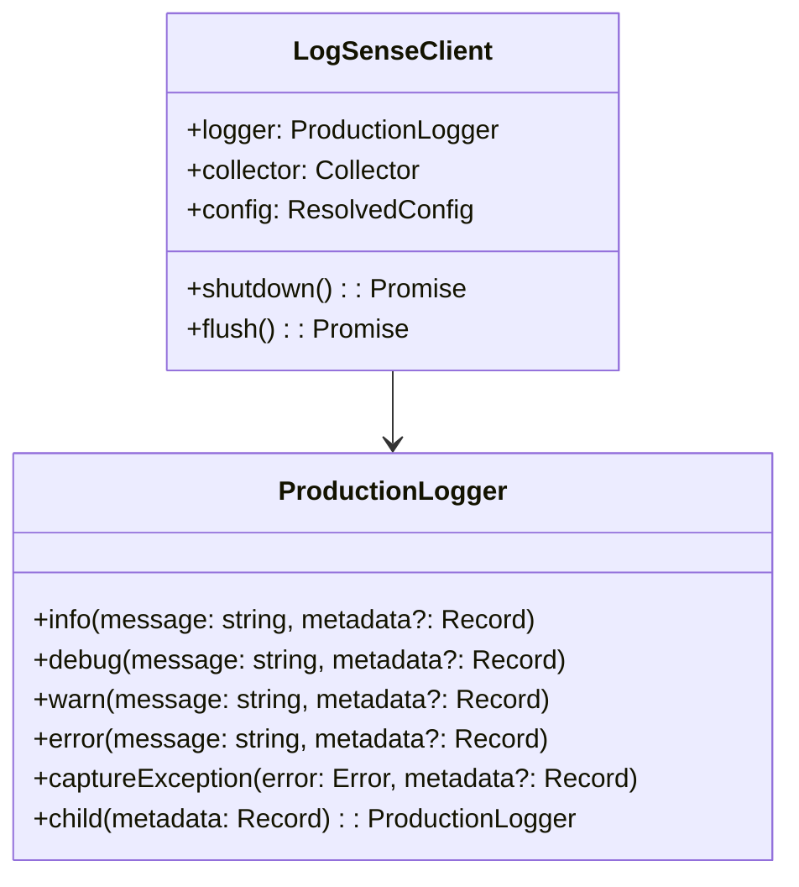
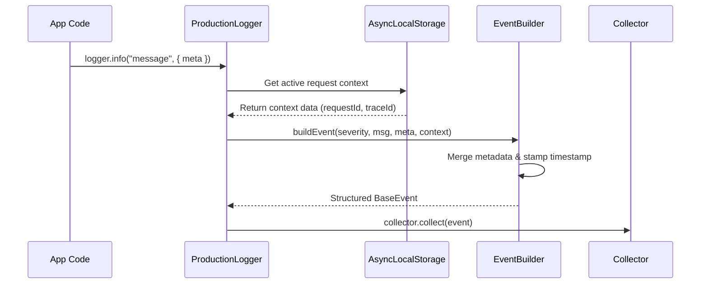

# Client & Logging APIs

This page details the public classes, logger instances, and manual instrumentation APIs.

---

# Purpose

The logging API provides structured logging, exception capturing, and context propagation functions. It translates custom log messages and raw error objects into unified event payloads containing system variables and runtime context.

---

# Class Architectures



---

# API Reference

### `LogSenseClient` (Named Alias: `LogSense`)

#### `new LogSense(config: SDKConfig)`
Initializes the SDK instance, configures telemetry queues, and hooks process termination handlers.

#### `client.flush(): Promise<void>`
Triggers an immediate network push of all currently buffered events. Returns a promise that resolves once the batch is transmitted.

#### `client.shutdown(): Promise<void>`
Flushes the queue, terminates timers, unregisters process lifecycle listeners, and shuts down network channels.

---

### `ProductionLogger`

#### `logger.info(message: string, metadata?: Record<string, any>)`
Emits an informational event. Recommended for application state shifts, business milestones, and request summaries.

#### `logger.debug(message: string, metadata?: Record<string, any>)`
Emits a debug level event. Suppressed in production configurations to optimize ingestion costs and memory.

#### `logger.warn(message: string, metadata?: Record<string, any>)`
Emits a warning event. Emitted automatically during slow database operations or near-limit resource conditions.

#### `logger.error(message: string, metadata?: Record<string, any>)`
Emits an error event. Captures failures, operational faults, and custom telemetry data.

#### `logger.captureException(error: Error, metadata?: Record<string, any>)`
Intercepts an active JS Exception. Extracts stack traces, line locations, error class names, and computes the fingerprint hash.

#### `logger.child(metadata: Record<string, any>): ProductionLogger`
Creates a context-bound child logger. All subsequent logs sent through this child instance inherit these fields.

---

# Code Examples

### 1. Structured Custom Logs
```typescript
import { LogSense } from "@logsense/node";

const sdk = new LogSense({ apiKey: "...", service: "order-service" });

sdk.logger.info("Inventory check initiated", {
  sku: "PROD-1029",
  requestedQuantity: 50,
  warehouseZone: "A-12"
});
```

### 2. Deep Exception Diagnostics
```typescript
import { LogSense } from "@logsense/node";
const sdk = new LogSense({ apiKey: "..." });

try {
  throw new TypeError("Cannot read property 'id' of undefined");
} catch (error) {
  sdk.logger.captureException(error as Error, {
    subsystem: "billing-engine",
    transactionId: "tx_992",
    retriedAttempts: 3
  });
}
```

### 3. Hierarchical Child Loggers
```typescript
import { LogSense } from "@logsense/node";
const sdk = new LogSense({ apiKey: "..." });

// Create a logger scoped to a specific payment transaction
const txLogger = sdk.logger.child({
  transactionId: "tx_abc_123",
  paymentGateway: "Stripe",
  merchantCountry: "DE"
});

txLogger.info("Authorizing card"); // Merges transactionId, paymentGateway, etc.
txLogger.info("Capture response received", { feeCharged: 12.5 });
```

### 4. Direct Flushing in Serverless/Short-Lived Tasks
```typescript
import { LogSense } from "@logsense/node";
const sdk = new LogSense({ apiKey: "..." });

export async function handler() {
  sdk.logger.info("Lambda invocation started");
  
  // Business logic here...
  
  sdk.logger.info("Lambda invocation completed");
  
  // Block and ensure logs are sent before AWS freezes the execution context
  await sdk.flush();
}
```

---

# Internal Flow



---

# Design & Runtime Considerations

### Memory Overhead
Each log payload created represents a temporary allocation in the V8 heap. To prevent excessive Garbage Collection (GC) sweeps under high throughput:
*   Avoid logging massive objects (e.g. raw request payloads, binary buffers, complete DB records).
*   Create child loggers once during component construction instead of inside hot functions or request loops.

### Thread and Event Loop Safety
All formatting, enrichment, and batching steps are strictly non-blocking. The event dispatch routines use internal ticks (`setImmediate`/`process.nextTick`) to distribute processing loads, preventing CPU spikes.

### Error Handling Boundaries
If a logging statement fails due to circular references in your metadata object or missing fields, the logger intercepts the exception silently, logs a safe warning string to stderr (if `debug: true`), and allows your core application execution path to continue without crashing.
